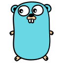
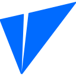
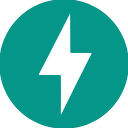
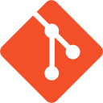
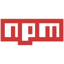

  

  

 

---

## 👨‍💻 About Me

I'm an **IT Software Developer** based in the Philippines. I build and maintain web applications and internal business systems — mostly **Laravel on SQL Server** for the enterprise side, and the **Next.js / React / TypeScript** stack when a project calls for a modern front end.

- 🔭 Building and maintaining enterprise web applications at Fujifilm Optics Philippines Inc (FOPH)
- 🧩 Full-stack work across Laravel/PHP and the Next.js, React, Prisma and Tailwind ecosystem
- ⚡ Real-time features with WebSockets, and event-driven backends for long-running processing
- 🖥️ Developer tooling and editor plugins in JavaScript, CSS and Luau
- 🐍 Python for desktop and automation tools
- ☁️ Docker, Git and CI workflows for day-to-day delivery
- 💬 Ask me about **Laravel**, **PHP**, **TypeScript**, **SQL Server**, and anything web-related
- ⚡ Outside code: I enjoy reading, watching videos, memes, technology, and eating
- 📍 Philippines 🇵🇭

 
 

---

## 🛠️ Tech Stack

### Languages

<picture><source media="(prefers-color-scheme: dark)" srcset="assets/icons/go-dark.svg"></picture>

### Libraries

### Frameworks

<picture><source media="(prefers-color-scheme: dark)" srcset="assets/icons/express-dark.svg"></picture><picture><source media="(prefers-color-scheme: dark)" srcset="assets/icons/socketio-dark.svg"></picture><picture><source media="(prefers-color-scheme: dark)" srcset="assets/icons/bootstrap-dark.svg"></picture>

### Databases

<picture><source media="(prefers-color-scheme: dark)" srcset="assets/icons/sqlite-dark.svg"></picture>

### Tools

<picture><source media="(prefers-color-scheme: dark)" srcset="assets/icons/bun-dark.svg"></picture><picture><source media="(prefers-color-scheme: dark)" srcset="assets/icons/zustand-dark.svg"></picture>

---

## 📊 GitHub Stats

  
  
   
  

 

---

 

---

## 😂 Random Meme

<!-- MEME_START -->

  
   
  <i>"Where, Who and What?"</i>

<!-- MEME_END -->

 

---

## 💭 Random Quote

<!-- QUOTE_START -->

  

<!-- QUOTE_END -->

 

---

## 🤝 Connect With Me

  
  
  
  

 

---

  ⭐ From <a href="https://github.com/ITSyndicate25">ITSyndicate 25</a>

